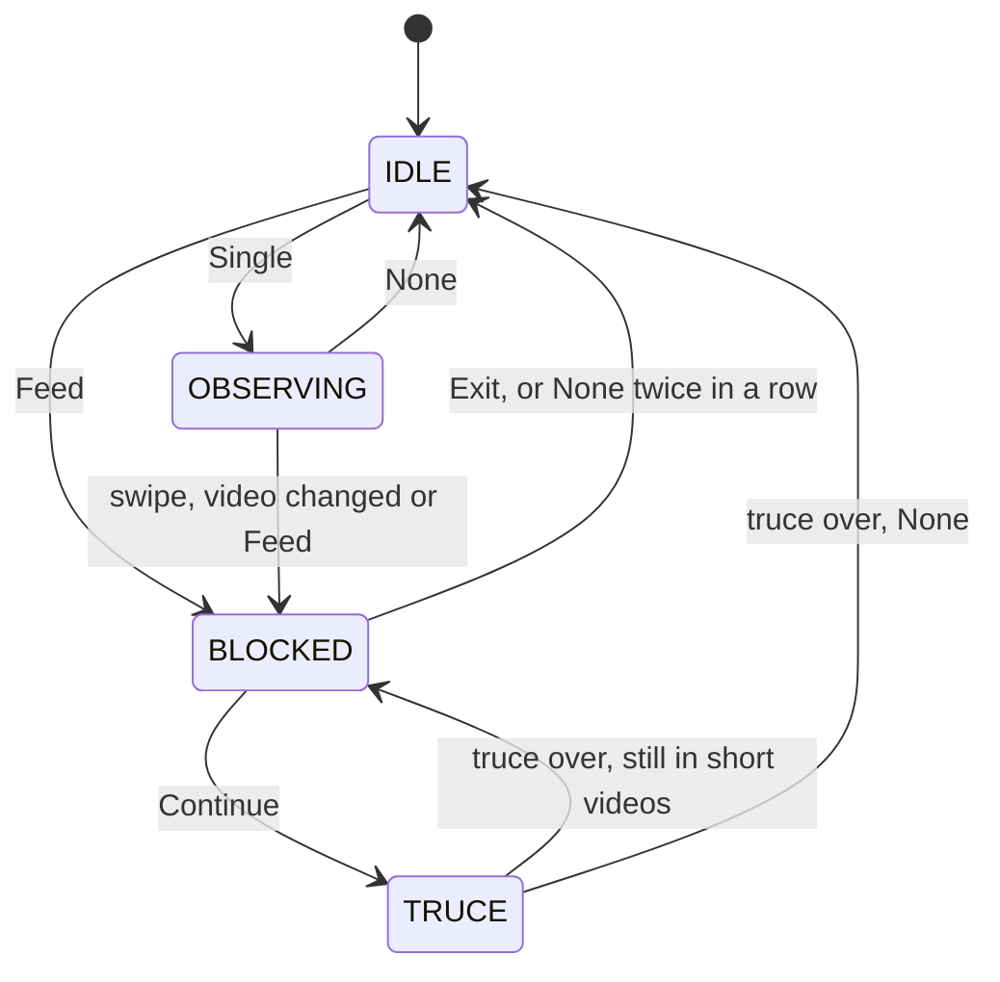

# Architecture

Reels Killer is a single Android module (`app/`) running in one process: an accessibility
service that watches the screen, and a Compose activity for the settings.

## Packages

All under `app/src/main/java/app/bloccareels/`.

| Package | What it does | Depends on Android |
|---|---|---|
| `detect` | The rules schema (`Rules.kt`) and `DetectorEngine`, which matches the rules against the `UiSnapshot` interface. | No |
| `block` | The blocking state machine (`BlockController`) and the wait before Continue (`DelayPolicy`). Side effects go through `BlockActions`. | No |
| `service` | `ReelsBlockerService`: receives accessibility events, throttles them, builds a `NodeSnapshot` and connects the controller to Android. Also `StatusNotification` and the saved counters (`RepoCounters`). | Yes |
| `overlay` | The block screen window (`OverlayManager`, `OverlayBinder`), custom media playback and audio muting (`AudioDucker`). | Yes |
| `data` | Settings (`Settings`, and `SettingsRepository` on DataStore), media import, language. | Partly |
| `diag` | The in-memory diagnostics log and the screen tree export used to write rules. | Partly |
| `ui` | Compose screens. They reach the rest of the app only through `UiModel`. | Yes |
| `update` | Installing an update from an APK picked by the user. | Yes |

`App.kt` holds `AppContainer`, the objects shared by the service and the activity.
The plain Kotlin parts are covered by the unit tests in `app/src/test`.

## From an event to the block screen

1. Android sends an accessibility event to `ReelsBlockerService`.
2. While nothing is in progress, events from apps that are not monitored are dropped early.
   The others are throttled (`THROTTLE_MS`).
3. The service wraps the foreground window in a `NodeSnapshot` and asks `DetectorEngine` for a
   `Detection`: `None`, `Feed` (the short-video section) or `Single` (one video, for example
   opened from a chat).
4. `BlockController.onDetection` updates the state machine and, through `BlockActions`, shows or
   hides the block screen, mutes or restores the audio, and performs Back or Home.

## Block states

From any state, turning the screen off, leaving the host app, stopping the service or turning
blocking off go back to `IDLE`. `BlockState` describes each state, and `BlockController`
documents every transition and its timings.

## Detection rules

`app/src/main/assets/rules.json` lists, for each host app, its packages and the rules that
recognise short videos. A rule matches when all its `allOf` conditions and at least one of its
`anyOf` conditions match a visible node. The first matching rule wins, and its `mode` (`feed` or
`single`) decides how the controller reacts. The schema is documented in `detect/Rules.kt`.

An unknown `mode` or `exitAction` makes the whole file invalid. `DetectorEngineTest` loads the
bundled file, so a broken file fails the unit tests and CI.

To update a rule, export the screen tree from the app's Diagnostics section (see the README).

## Values that must not change

Some values are saved on the device or registered with the system. Renaming them would lose
users' settings or leave stale entries behind. Each is marked with a comment in the code.

- The DataStore keys in `SettingsRepository` and the `Illustration` keys
  (`tramonto`, `tazza`, `foglia`, `personalizzato`).
- The notification channel id `stato` in `StatusNotification`.
- The audio marker file name `audio_silenziato` in `AudioDucker`.
- The `applicationId` `app.bloccareels`: changing it would make the app a different app,
  and updates would no longer install over existing ones.
